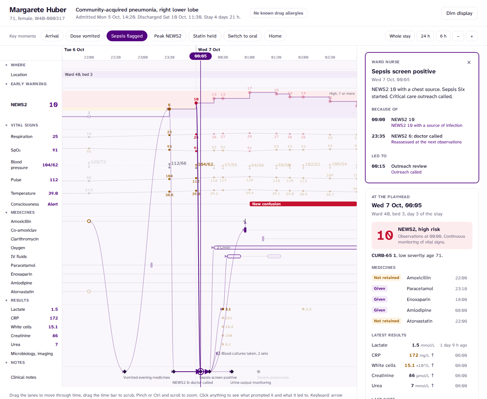
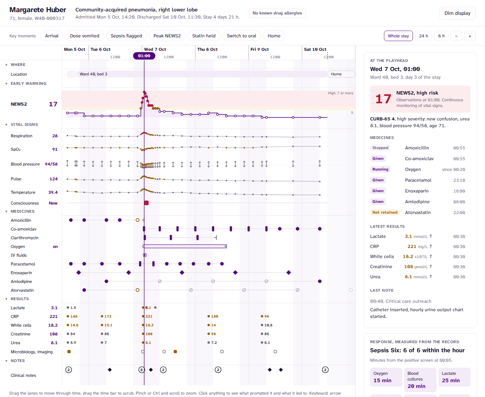
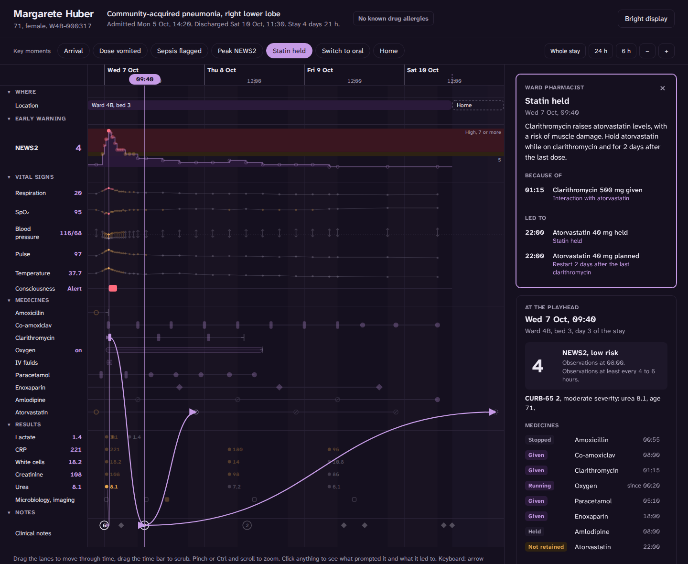

# Patient timeline

Live: https://patient-timeline-rho.vercel.app

One hospital admission on one clock. Observations, medicines, results and notes sit in
lanes on a shared time axis that you can drag, zoom and scrub. Every decision is joined to
what prompted it.



A record answers "what is true now" well and "how did we get here" badly. That second question
lives across five screens: the observation chart, the drug chart, the results viewer, the notes
and the handover sheet. This interface puts them on one axis and adds the one thing none of
them stores, which is *because*.

- **Decision chains.** Click the positive sepsis screen at 00:05. The chain is drawn back to
  the NEWS2 of 10 that triggered it, the NEWS2 of 6 half an hour earlier, the repeat
  observations ordered after she vomited, and the 22:00 amoxicillin dose she vomited. It is
  also drawn forward to outreach, oxygen, cultures, lactate, fluids and the first intravenous
  antibiotic. Everything outside the chain fades back.
- **A playhead, not a page.** Drag the time bar and every lane reports its state at that
  minute: NEWS2 and the response it requires, CURB-65 with the criteria that count, which
  medicines are running, given, held or not retained, and the latest result of each test with
  its trend.
- **Semantic zoom.** The whole stay shows the shape: the dense cluster of observations on the
  worst night, the intravenous to oral switch, the held doses. Zoom in and the values,
  labels and individual doses appear. Detail is chosen from minutes per pixel, so a phone and
  a wide screen show the same window the same way. Busy notes merge into a count that zooms in
  when clicked.
- **Response, measured.** The Sepsis Six and its timings are computed from the record, not
  typed in. Oxygen came at 15 minutes, cultures at 20, lactate at 25, fluids at 30, urine
  output at 35 and antibiotics at 50. The panel also shows the time from the first NEWS2 of
  5 or more to clinical review (45 minutes) and the time at high risk (5 hours).



## The patient

Margarete Huber, 71, is fictional. She is Bed 3 in my [ward monitor](https://github.com/Henrycarto/ward-monitor).
The night she deteriorates uses the same vital-sign keyframes, and she reaches the same peak of
NEWS2 17 at 01:00. Here the record goes on: the team responds and she goes home four days later.

The course is built to be clinically coherent, and the tests hold it to that:

- She is admitted with low-severity pneumonia (CURB-65 1, age) on oral amoxicillin and
  vomits the 22:00 dose on day 2. No antibiotic reaches her for nearly 11 hours, until the
  sepsis response.
- A pneumococcal urinary antigen comes back positive, so clarithromycin is stopped.
- The pharmacist holds atorvastatin because clarithromycin raises statin levels. It restarts
  2 days after the last clarithromycin dose, which falls on the evening she goes home.
- Amlodipine is held while her blood pressure recovers.
- She switches from intravenous to oral antibiotics once she has had no fever for over 24
  hours and her CRP is falling.

**When observations were taken is not authored.** It follows the NEWS2 rule for how often to
observe at each score: every 12 hours at 0, every 4 hours at 1 to 4, hourly at 5 or 6 or with
a single 3, and continuously at 7 or more (charted every 30 minutes). Sets fall on ward round
times, and four extra sets were charted by a nurse for a reason written on the chart. The
density of the chart on the worst night is the rule at work.

The decisions made that night, with the rules behind them, are in [decision-cockpit](https://github.com/Henrycarto/decision-cockpit).

## Clinical logic, tested

90 tests, including:

- NEWS2 band edges from both sides and both SpO₂ scales, shared with the ward monitor.
- CURB-65 at every threshold, counting low blood pressure once, and scoring as CRB-65 when
  urea has not been measured. CURB-65 is 1 in the emergency department and 4 at 01:10,
  matching the notes.
- The observation schedule never leaves a gap longer than the previous score allows.
- The vital signs match the ward monitor's Bed 3 keyframes minute for minute until the
  response.
- Every link points at a real event and never runs backwards in time. These tests caught two
  data errors while I built it.
- State at a moment: which medicines are running, given, held, stopped or lapsed, plus CURB-65
  and the latest results.
- The Sepsis Six timings, time at high risk and time to review.
- Timeline geometry: zoom about the pointer, panning stops at the edges, tick spacing, level
  of detail, clustering and lane layout with collapsed groups.

## Design

Same design system as the ward monitor. White with one purple for interaction. Amber and red
appear only where a clinical rule puts them: the NEWS2 bands, each vital sign coloured by the
points it scores, results outside their reference range, a dose not retained. The typeface is
Atkinson Hyperlegible Next, bundled with the app so it works on hospital networks that block
font hosts. Dim display follows the system or the button.

- **Lanes:** where the patient was, NEWS2 as a step line over its thresholds, six vital signs
  (blood pressure drawn as systolic and diastolic bars), nine medicines, five blood tests,
  microbiology and imaging, and clinical notes. Nights are shaded, and each group collapses
  to its header.
- **Doses** are drawn by route: oral as a dot, intravenous as a bar, subcutaneous as a diamond.
  Fill shows status: given, held, not retained or planned.
- **Input:** drag the lanes to pan, drag the time bar to scrub, pinch or Ctrl and scroll to zoom.
  The arrow keys step through events, + and − zoom, 0 shows the whole stay and Esc clears the
  selection. Links such as `?at=wed-01:05` and `?event=sepsis` open at a moment.
- **Phone:** the same lanes with a narrower label column, and the panel below.



## Run it

```bash
npm install
npm run dev
npm test && npm run lint && npm run typecheck
npm run build          # static site in dist/
npm run build:single   # one self-contained HTML file in dist-single/
```

## Not a medical device

A fictional patient and a simulated record, for demonstrating interface design and clinical
logic. It is not validated for clinical use and must not be used to make clinical decisions.

## Author

Samuel Henry Mba
